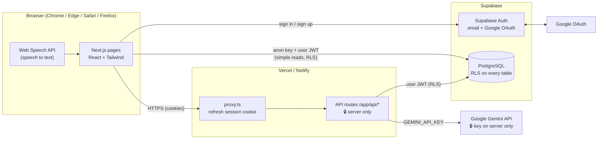
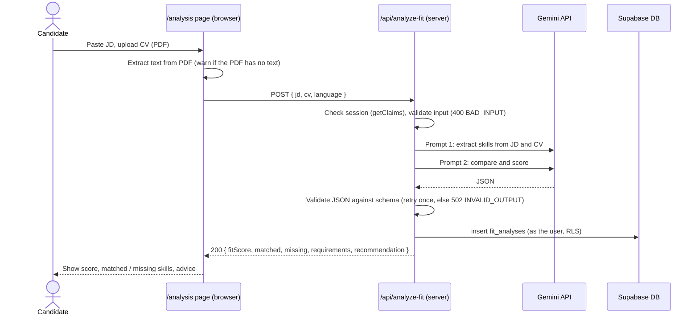
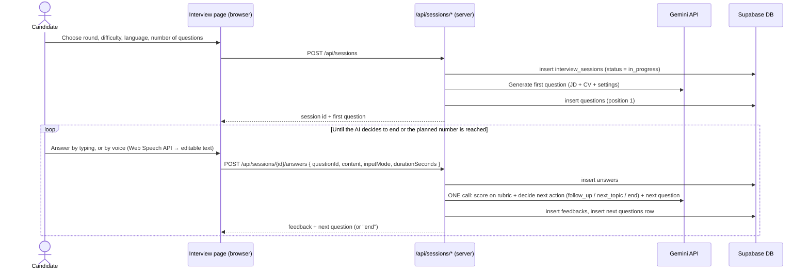
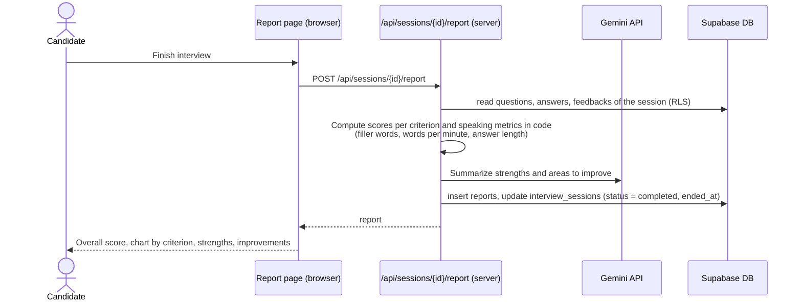

# InterviewBuddy – System Architecture (draft v0.1)

Author: Nguyen Tran Trung Nhan · Sprint 2, week 3 · Status: **draft, waiting for team agreement on Slack**

> Superseded by the Software Architecture Document v1.0 (`InterviewBuddy_Software_Architecture_Document_v1.0.docx`, Sprint 2 week 4). This page is kept as the week-3 draft.

This document describes the high-level architecture, the main data flows and where secrets live. The database is described in [database-design.md](database-design.md).

## 1. Overview

InterviewBuddy is a single Next.js application deployed on Vercel (or Netlify). The same codebase contains:

- **Pages** (React, App Router) that run in the browser.
- **API routes** (Route Handlers under `/app/api`) that run on the server. Only these talk to Gemini or use secret keys.
- **Proxy** (`/proxy.ts`, called "middleware" before Next.js 16) that refreshes the Supabase session cookie on every request.

Supabase provides authentication (email/password and Google) and a PostgreSQL database protected by Row Level Security (RLS). Google Gemini provides all AI features.

### 1.1 What runs where

| Part | Runs on | Can use secret keys? | Notes |
| --- | --- | --- | --- |
| Pages and Client Components | Browser | No | Only `NEXT_PUBLIC_*` variables are visible here. |
| Server Components | Server | Yes, but avoid | Read data for the page with the server Supabase client. |
| API routes (`/app/api/*`) | Server | **Yes** | The only place that calls Gemini or uses `SUPABASE_SERVICE_ROLE_KEY`. |
| `proxy.ts` | Server (edge of each request) | No | Refreshes the session cookie; later also redirects signed-out users to `/login`. |
| Speech to text | Browser | No | Web Speech API; the text can be edited before it is sent. |

### 1.2 Supabase clients in the code

| File | Use from | Key | RLS |
| --- | --- | --- | --- |
| `lib/supabase/client.ts` | Client Components | anon key | Applies (acts as the signed-in user) |
| `lib/supabase/server.ts` | Server Components, API routes | anon key + session cookie | Applies (acts as the signed-in user) |
| `lib/supabase/admin.ts` | API routes only | service_role key | **Bypassed** – only for system tasks such as opening a shared report by its link |
| `lib/supabase/proxy.ts` | `proxy.ts` | anon key | Refreshes the session |

Rule: API routes use `server.ts` by default, so the database itself checks that the user owns the data. `admin.ts` is the exception and must be reviewed by Nhân.

## 2. Data flows

### 2.1 Analyze CV against JD (`/analysis` → `/api/analyze-fit`)

Errors follow the API contract in the week-3 guide: `400 BAD_INPUT`, `429 RATE_LIMIT`, `502 INVALID_OUTPUT`, `500 SERVER_ERROR`.

Note: `pdf-parse` is a Node.js library. If it cannot run in the browser, extract the text in a small server route (for example `/api/extract-cv`) instead; the contract of `/api/analyze-fit` does not change because it receives text.

### 2.2 Run a mock interview

- One Gemini call per answer (score + next action + next question) keeps us inside the free-tier quota.
- Every turn is saved immediately, so a closed tab can resume the session (non-functional requirement).
- The exact routes are proposals; the session API contract is due Monday 2/11 (week 4).

### 2.3 Generate the post-interview report

Scores and speaking metrics are computed in code from stored data, not by the AI, so the numbers are consistent and testable. Gemini only writes the text summary.

## 3. Secrets and environment variables

| Variable | Visible in browser? | Where it is set |
| --- | --- | --- |
| `NEXT_PUBLIC_SUPABASE_URL` | Yes | `.env.local`, hosting dashboard |
| `NEXT_PUBLIC_SUPABASE_ANON_KEY` | Yes (protected by RLS) | `.env.local`, hosting dashboard |
| `SUPABASE_SERVICE_ROLE_KEY` | **Never** | `.env.local`, hosting dashboard |
| `GEMINI_API_KEY` | **Never** | `.env.local`, hosting dashboard |
| `GEMINI_MODEL` | No (not secret) | `.env.local`, hosting dashboard |
| `GOOGLE_CLIENT_ID` / `GOOGLE_CLIENT_SECRET` | Secret: never | Supabase > Authentication > Providers > Google |

`src/.env.example` lists the names with empty values. Files matching `.env*` are git-ignored, except `.env.example`.

## 4. Auth configuration checklist (Supabase dashboard)

- Authentication > Providers: enable **Email** and **Google** (paste the Google client ID and secret).
- Authentication > URL Configuration:
  - Site URL: the staging URL.
  - Redirect URLs: `http://localhost:3000/auth/callback`, `<staging-url>/auth/callback`, and the preview pattern (for Vercel: `https://*-<team>.vercel.app/auth/callback`).
- Google Cloud Console > OAuth client > Authorized redirect URI: `https://<project-ref>.supabase.co/auth/v1/callback`.

## 5. Open questions for the team

1. Hosting: Vercel or Netlify? (Nguyên decides when deploying.)
2. Rubric scale: 0–10 per criterion is proposed in the database. OK?
3. Text extraction from PDF: in the browser or in a server route (see 2.1)?
