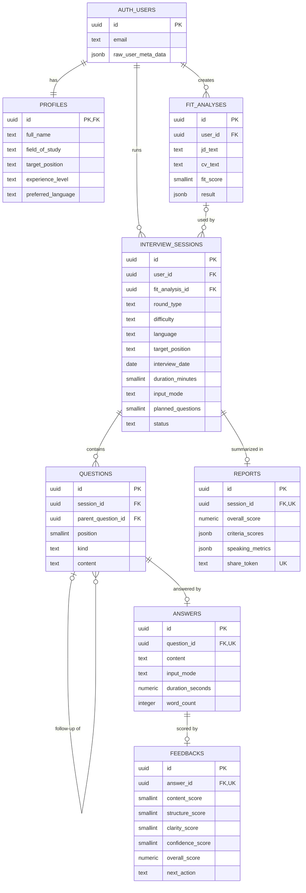

# InterviewBuddy – Database Design (v1.0)

Author: Nguyen Tran Trung Nhan · Sprint 2, week 4 · Status: **matches the Supabase database after both migrations below**

Database: Supabase (PostgreSQL 17). Migrations, applied in order:

1. [`20261021000000_initial_schema.sql`](../../src/supabase/migrations/20261021000000_initial_schema.sql) – the 7 tables and RLS.
2. [`20261030000000_interview_session_settings.sql`](../../src/supabase/migrations/20261030000000_interview_session_settings.sql) – Interview Setup fields (UC-05) and the ownership check for linked analyses.

Change the schema only with a new migration file, never by hand in the dashboard.

## 1. Entity–relationship diagram

## 2. Tables

**Users** are not a separate table: Supabase Auth stores them in `auth.users`. `profiles` holds our own user data and is created automatically by a trigger when someone signs up.

| Table | Feature | Key columns | Relationships |
| --- | --- | --- | --- |
| `profiles` | Sign-up, login and profile | `id` = `auth.users.id`; field of study, target position, experience level, preferred language (`vi`/`en`) | 1–1 with `auth.users`; deleted with the user |
| `fit_analyses` | JD and CV fit analysis | `jd_text` (≤ 3000 chars), `cv_text`, `fit_score` (0–100), `result` (full `/api/analyze-fit` JSON) | many per user |
| `interview_sessions` | Interview setup, chat interview, history | `round_type` (`hr`/`technical`/`behavioral`), `difficulty`, `language`, `target_position` (1–120 chars), `interview_date` (optional), `duration_minutes` (15/30/45), `input_mode` (`text`/`voice`), `planned_questions` (1–20, derived from the duration), `status` (`in_progress`/`completed`/`abandoned`), JD/CV snapshot | many per user; optional link to a fit analysis (set to null if it is deleted) |
| `questions` | Chat interview, targeted practice | `position` (unique per session), `kind` (`main`/`follow_up`/`practice`), `parent_question_id` for follow-ups | many per session |
| `answers` | Chat interview, voice answers | `content`, `input_mode` (`text`/`voice`), `duration_seconds`, `word_count` | at most one per question |
| `feedbacks` | Per-answer scoring and feedback | 4 rubric scores 0–10 (content, STAR structure, clarity, confidence), `overall_score`, explanation, strengths, improvements, sample answer, `next_action` (`follow_up`/`next_topic`/`end`) | at most one per answer |
| `reports` | Post-interview report, sharing | `overall_score`, `criteria_scores`, `speaking_metrics`, strengths, improvements, `share_token` | at most one per session |

Deleting a user deletes all of their data (`on delete cascade`). Deleting a session deletes its questions, answers, feedback and report.

Not in this migration (added in later sprints when the features are built): bookmarks (history and progress tracking), practice plans (practice-plan agent).

## 3. Row Level Security (RLS)

RLS is enabled on **every** table. Without a matching policy, a request with the anon key sees nothing.

| Table | Who can read / write | How it is checked |
| --- | --- | --- |
| `profiles` | Owner: read, update | `id = auth.uid()` |
| `fit_analyses` | Owner: all operations | `user_id = auth.uid()` (`user_id` defaults to `auth.uid()`) |
| `interview_sessions` | Owner: all operations; a linked analysis must also be the owner's | `user_id = auth.uid()` and `owns_fit_analysis(fit_analysis_id)` |
| `questions`, `reports` | Owner of the session | `owns_session(session_id)` |
| `answers` | Owner of the question's session | `owns_question(question_id)` |
| `feedbacks` | Owner of the answer's session | `owns_answer(answer_id)` |

- Shared reports are **not** readable through RLS. A server route finds the report by `share_token` with the service_role client and shows a read-only page. Setting `share_token` back to null revokes the link.
- The service_role key bypasses RLS, so it is used only on the server (`lib/supabase/admin.ts`).

## 4. Verification

The migration was run on a local PostgreSQL (PGlite) with stand-ins for `auth.users` and `auth.uid()`. Results:

| Check | Result |
| --- | --- |
| Both migrations run without errors | Pass |
| New setup fields: defaults (30 min, text), invalid duration / answer mode / empty position rejected | Pass |
| B cannot link a session to A's analysis, on insert or update | Pass (blocked by RLS) |
| Sign-up creates a profile with the name from email or Google metadata | Pass |
| User A sees only A's rows in all 7 tables; user B sees none of them | Pass |
| B cannot add questions or answers to A's session, create a session for A, or move a session to A | Pass (blocked by RLS) |
| B's update / delete on A's rows affects 0 rows | Pass |
| Scores outside 0–10, JD over 3000 characters, duplicate question position | Pass (rejected by constraints) |
| Deleting a user removes all of their data | Pass |

To apply on Supabase: SQL Editor > New query > paste the migration file > Run. Then check that Table Editor shows "RLS enabled" on all 7 tables.
