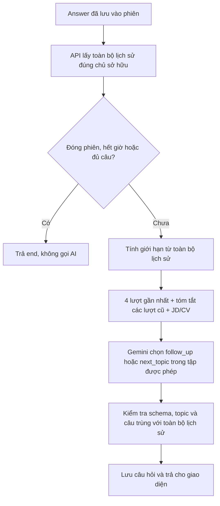

# SCRUM-93 — phân tích, triển khai và giải thích

Ngày kiểm tra: 05/11/2026, giờ Việt Nam. Nhánh triển khai: `feat/scrum-93-interview-flow`, dựa trên commit SCRUM-92 `0d856ec`. Ở thời điểm kiểm thử, `origin/main` vẫn ở `0277462`; chưa thay đổi trạng thái/người phụ trách Jira và chưa commit/push phần SCRUM-93. Thông tin phát hành sau đó được ghi trong pull request và comment Jira.

## 1. Yêu cầu đã đọc trên Jira

[SCRUM-93](https://nhom3-24c01-se.atlassian.net/browse/SCRUM-93) yêu cầu quyết định bước kế tiếp: hỏi sâu khi câu trả lời mơ hồ hoặc có chi tiết đáng khai thác; chuyển chủ đề trong các trường hợp khác; kết thúc khi đủ câu hoặc hết thời gian. Mỗi lần gọi AI gửi 4 lượt gần nhất cùng bản tóm tắt ngắn để hạn chế hỏi lặp. Task đang In Progress, không có mô tả chi tiết và subtask chưa được gán người phụ trách.

Trong triển khai này, một lượt là một cặp câu hỏi–câu trả lời đã hoàn tất. Câu hỏi chưa trả lời không được tính vào bốn lượt đó.

## 2. Phần đã làm trước và phần bổ sung lần này

| Phần | Chức năng và trạng thái |
| --- | --- |
| SCRUM-92, đã push commit `0d856ec` | Tạo `/api/interview/next`; lấy phiên đúng người đăng nhập; lấy JD/CV/cấu hình; chọn trọng tâm; gọi Gemini; kiểm tra/lưu câu hỏi; xử lý request đồng thời và request gửi lại. |
| Chính sách có sẵn được dùng lại | Backend đếm câu chính, giới hạn follow-up easy/medium/hard, quyết định hết giờ/đủ câu/đóng phiên; validator chặn câu hỏi trùng sau chuẩn hóa. |
| SCRUM-93, đã triển khai local | Chỉ gửi bốn cặp gần nhất; rút gọn lịch sử cũ; làm rõ ưu tiên câu trả lời mới nhất và nhãn follow_up/next_topic; thêm metadata memoryVersion; thêm kiểm thử và báo cáo. |
| Còn chờ tích hợp nhóm | Supabase chung, API lưu answer và trang Chat; streaming thuộc SCRUM-94. Không tạo điểm đánh giá hoặc report giả. |

## 3. Skill liên quan và cách áp dụng

| Skill | Đã áp dụng vào đâu |
| --- | --- |
| `gemini-api-dev` | Đọc tài liệu Google hiện tại về context, structured output và generateContent; giữ schema bốn trường; đặt quy tắc quyết định trong system prompt; coi CV/JD/answer/summary là dữ liệu không đáng tin; không thêm retry trả phí ngầm. |
| `supabase-postgres-best-practices` | Đối chiếu hướng dẫn transaction ngắn và ownership/RLS; lấy lịch sử từ snapshot phiên đã kiểm tra quyền, giữ nguyên claim/finish/release; lưu phiên bản bộ nhớ trong metadata có sẵn. Không cần migration hoặc bảng summary mới. |

Đã xem xét `ai-sdk`: package `ai` không có trong ứng dụng và task này dùng được REST provider hiện tại, nên không thêm SDK/dependency. Không cần skill thiết kế giao diện hoặc viết Word/PDF vì lần này là logic server và tài liệu Markdown.

Nguồn kỹ thuật: [Google generateContent](https://aistudio.google.com/api-reference/generate-content/generate-content), [structured outputs](https://aistudio.google.com/docs/structured-output), [long context](https://aistudio.google.com/docs/long-context), [skill chính thức Supabase](https://github.com/supabase/agent-skills/tree/main/skills/supabase-postgres-best-practices). Chính sách 4 lượt xuất phát từ Jira; giới hạn summary 6000 là lựa chọn triển khai của nhóm, không phải hạn mức Google.

## 4. Cách hệ thống vận hành



Ví dụ phiên có 9 cặp đã trả lời: server vẫn đọc đủ 9 cặp để biết đã hỏi bao nhiêu câu chính và có hỏi trùng hay không. Gemini nhận nguyên văn cặp 6–9; cặp 1–5 được rút thành các chủ đề đã hỏi, bộ đếm main/follow-up và một số đoạn trích. Không xóa nội dung cũ trong database.

Tóm tắt được tạo bằng code từ dữ liệu đã lưu, không gọi Gemini lần thứ hai. Bản tóm tắt tối đa 6000 đơn vị UTF-16 của JSON; tối đa sáu đoạn trích, ưu tiên lượt cũ gần đây hơn. Khi phải rút ngắn hoặc bỏ đoạn trích, có cờ và số lượng tương ứng. Vì là tóm tắt có mất thông tin, prompt không được coi đoạn trích là toàn bộ câu trả lời hoặc bằng chứng ứng viên đã có kỹ năng.

| Tình huống | Hệ thống xử lý |
| --- | --- |
| “Tôi dùng transaction, database tự lo concurrency” | Khi còn lượt hỏi sâu, AI hỏi cơ chế cụ thể chống overselling; action là follow_up. |
| Đã giải thích transaction nhưng nói cache vẫn stale, chưa điều tra | AI hỏi sâu chi tiết cache vừa nêu, giữ nguyên topic hiện tại. |
| Trả lời đầy đủ, không còn chi tiết hữu ích cần làm rõ | Chuyển sang kỹ năng khác trong JD. |
| Nói không biết hoặc yêu cầu bỏ qua | Chuyển câu, tránh liên tục ép trả lời cùng nội dung. |
| Hết trần follow-up | Server chỉ cho phép next_topic. |
| Hết giờ, đủ câu chính hoặc phiên đã đóng | Server trả end, không gọi Gemini. |

Phân loại “mơ hồ/đáng hỏi sâu” vẫn do model đánh giá nội dung trong phạm vi server cho phép. Không dùng số từ làm tiêu chí giả định câu trả lời đúng/sai. Giới hạn cứng và chặn câu trùng chuẩn hóa là các kiểm tra bằng code.

## 5. Các file và cách thử lại

| File trong repo | Vai trò |
| --- | --- |
| `src/lib/interview/conversation-memory.mjs` và `.d.mts` | Tạo bốn lượt gần nhất và tóm tắt có giới hạn. |
| `src/lib/interview/interviewer-prompt.mjs` | Prompt v0.8, quy tắc quyết định và đưa memory vào request Gemini. |
| `src/lib/interview/next-service.mjs` | Ghi memoryVersion khi lưu generation. |
| `src/lib/interview/interview-flow-fixtures.mjs` | Chín tình huống giả lập, không có CV thật. |
| `src/tests/interview-flow.test.mjs` | 16 test bổ sung về memory, counters, duplicate, persistence và replay. |
| `src/scripts/verify-interview-flow.mjs` | Thử qua HTTP handler thật, DB cục bộ và Gemini thật khi bật live. |

Trong `D:/BackUp/HCMUS_Semester_7/introSE/project/main/src`:

```powershell
npm test
npm run typecheck
npm run build
npm run verify:interview-flow
```

Lệnh cuối chỉ chuẩn bị fixtures. Khi `.env.local` có khóa Gemini hợp lệ, có thể chạy lệnh dùng quota:

```powershell
npm run verify:interview-flow:live
npm run verify:interview-flow:live -- --case long-memory-en
```

Chọn ca bằng `--case` khi chỉ cần kiểm tra lại trường hợp vừa sửa. Lệnh toàn bộ ghi đè `scrum93-flow-live.json`; ca riêng ghi file có hậu tố ID. Không dán khóa vào code, fixture, URL hoặc báo cáo.

## 6. Bằng chứng và giới hạn kết luận

- 169/169 test tự động đạt, tăng 16 so với SCRUM-92. Có test giữ nguyên bốn lượt mới, summary có giới hạn, topic có ký tự escape, không nhận summary từ client, chặn câu trùng nằm ngoài cửa sổ và giữ replay/persistence.
- Lần đầu prompt v0.5 có hai lỗi phân loại: câu hỏi bám chi tiết cache nhưng gắn next_topic; ca lịch sử dài bỏ qua câu trả lời mơ hồ mới nhất. Giữ nguyên bằng chứng tại `results/scrum93-flow-live-initial-v0.5.json`.
- Prompt v0.6 chạy đủ chín ca: cả chín HTTP 200, đúng hành động kỳ vọng và replay không gọi AI thêm. Sáu ca gọi Gemini; ba ca end không gọi AI. Xem `results/scrum93-flow-live.json`.
- Rà nội dung phát hiện ca chuyển chủ đề Behavioral v0.6 dùng câu giả định. Prompt v0.7 bổ sung yêu cầu trải nghiệm thật; câu trả về đã đúng dạng quá khứ nhưng vẫn gần chủ đề phối hợp xử lý sự cố của câu gốc. Giữ kết quả ở `results/scrum93-flow-live-behavioral-v0.7.json`.
- Prompt v0.8 làm rõ rằng đổi cách kể cùng năng lực vẫn là hỏi lặp. Đã thử lại riêng ca Behavioral: nhận next_topic về **chủ động phát hiện vấn đề/lỗi mà thành viên khác chưa nhận ra**, tách khỏi phối hợp sửa lỗi đã được trả lời. Replay vẫn giữ nguyên kết quả, không gọi AI thêm. Xem `results/scrum93-flow-live-developed-behavioral-vi.json`. Chưa chạy lại toàn bộ ma trận bằng v0.8; các lần kiểm tra v0.7/v0.8 chỉ nhắm ca Behavioral vừa có vấn đề.
- Tổng thử SCRUM-93 là 14 request Gemini thật: 6 ở v0.5, 6 ở v0.6, 1 ở v0.7 và 1 ở v0.8. Tất cả dùng dữ liệu tổng hợp do trợ lý tạo.
- Ca long-memory gửi 4 lượt nguyên văn + summary của 3 lượt trước. Phần lịch sử đo được giảm 6306 → 3770 ký tự, khoảng 40,2%. Đây là số ký tự của phần history/memory trong JSON, không phải token, tổng prompt, chi phí hoặc benchmark độ trễ. Ở phiên ngắn, metadata có thể làm payload tăng nhẹ.

Các kết quả trên là kiểm thử tự động và rà soát nội dung bởi Codex, chưa phải đánh giá độc lập của chuyên gia/người dùng. Không bảo đảm ngăn mọi câu hỏi trùng nghĩa; vẫn cần nhóm review. Không làm benchmark first-token hoặc streaming.

Supabase chung và đăng nhập thật qua endpoint vẫn chưa được thử vì môi trường local thiếu cấu hình Supabase. Không áp dụng migration lên cloud. Khi Nhân nối persistence answer và Khang nối Chat UI, request next vẫn giữ nguyên `{sessionId, afterAnswerId}`; phía giao diện không tự tạo summary hay bộ đếm.
